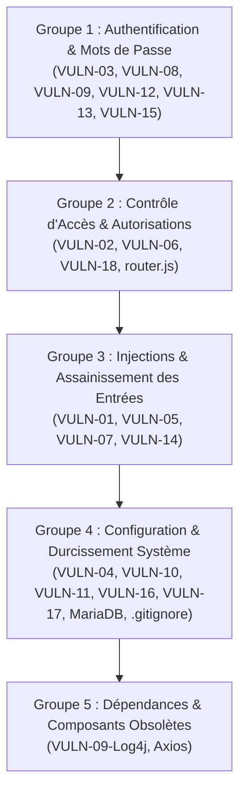

# Plan de Remédiation — Groupes d'Intervention DevFolio

Ce document regroupe les vulnérabilités identifiées dans le [**Rapport d'Audit de Sécurité Approfondi**](file:///home/user/devfolio-audit/RAPPORT_AUDIT_SECURITE_COMPLET.md) (VULN-01 à VULN-18) ainsi que les durcissements d'infrastructure complémentaires, organisés en **5 groupes d'intervention thématiques**.

> [!NOTE]
> La numérotation ci-dessous (**VULN-01 à VULN-18**) est **strictement alignée** sur le [Rapport d'Audit de Sécurité Approfondi](file:///home/user/devfolio-audit/RAPPORT_AUDIT_SECURITE_COMPLET.md).

---

## 🎯 Ordre de Traitement Recommandé



---

## 📋 Tableau Synthétique des Groupes (Aligné sur le Rapport d'Audit)

| Groupe | Thématique | Fichiers cibles | Vulnérabilités couvertes | Statut |
| :---: | :--- | :--- | :--- | :---: |
| **G1** | **Authentification & Mots de Passe** | `JwtService`, `AuthController`, `AuthService`, `SecurityConfig`, `init.sql` | **VULN-03**, **VULN-08**, **VULN-09 (logs)**, **VULN-12**, **VULN-13**, **VULN-15** | ✅ Terminé |
| **G2** | **Contrôle d'Accès & Autorisations** | `SecurityConfig`, `ProjectController`, `UserController`, `router/index.js` | **VULN-02**, **VULN-06**, **VULN-18** (+ route guard) | ⏳ À faire |
| **G3** | **Injections & Validation des Entrées** | `SearchController`, `ProjectRepository`, `AvatarController`, `ProfileView.vue`, `ProjectView.vue` | **VULN-01**, **VULN-05**, **VULN-07**, **VULN-14** | 🟡 En cours (VULN-01 traitée) |
| **G4** | **Configuration & Durcissement** | `application.properties`, `Dockerfile`, `SecurityConfig`, `docker-compose.yml`, `.env` | **VULN-04**, **VULN-10**, **VULN-11**, **VULN-16**, **VULN-17** (+ DB & ignores) | ⏳ À faire |
| **G5** | **Dépendances Obsolètes** | `backend/pom.xml`, `frontend/package.json` | **VULN-09 (Log4Shell)**, Axios v0.21 | ⏳ À faire |

---

## 🛡️ Groupe 1 : Authentification & Sécurité des Mots de Passe

> **Objectif :** Rendre l'identification robuste, protéger les secrets des utilisateurs en base et éliminer les fuites de données d'authentification.

### Fiches du Groupe 1
* **VULN-03 : Contournement de signature JWT (Algorithme "None")** ([`JwtService.java`](file:///home/user/devfolio-audit/backend/src/main/java/com/devfolio/service/JwtService.java))
  * *Problème :* Absence d'expiration stricte et bloc `catch` acceptant les tokens à 2 parties sans signature valide.
  * *Action :* Forcer la vérification de la signature cryptographique et définir une durée de validité limitée (`exp`).
* **VULN-08 : Hachage de mot de passe défaillant (MD5 sans sel)** ([`SecurityConfig.java`](file:///home/user/devfolio-audit/backend/src/main/java/com/devfolio/config/SecurityConfig.java))
  * *Problème :* Algorithme MD5 obsolète, vulnérable aux rainbow tables, renvoyant le mot de passe en clair dans le bloc `catch`.
  * *Action :* Remplacer par `BCryptPasswordEncoder` (coût 10 à 12).
* **VULN-09 (Partie Logs) : Mots de passe en clair dans les logs** ([`AuthController.java`](file:///home/user/devfolio-audit/backend/src/main/java/com/devfolio/controller/AuthController.java))
  * *Problème :* `log.debug("Password received: " + password)` consigne les mots de passe des utilisateurs dans `devfolio.log`.
  * *Action :* Supprimer toutes les instructions de log de mots de passe.
* **VULN-12 : Déni de Service applicatif & Usurpation par absence d'unicité d'email** ([`init.sql`](file:///home/user/devfolio-audit/database/init.sql), [`User.java`](file:///home/user/devfolio-audit/backend/src/main/java/com/devfolio/model/User.java))
  * *Problème :* Plusieurs comptes peuvent partager le même email, déclenchant un crash HTTP 500 (*Account DoS*) lors de `findByEmail`.
  * *Action :* Ajouter la contrainte `UNIQUE` sur le champ `email` en base et l'annotation `@Column(unique = true)` dans JPA.
* **VULN-13 : Énumération d'utilisateurs sur les formulaires d'authentification** ([`AuthController.java`](file:///home/user/devfolio-audit/backend/src/main/java/com/devfolio/controller/AuthController.java))
  * *Problème :* Réponses d'erreur différenciées (*"Utilisateur inconnu"* vs *"Mot de passe incorrect"*).
  * *Action :* Renvoyer un message d'erreur générique unique : *"Identifiants incorrects"* avec code HTTP 401.
* **VULN-15 : Divulgation du jeton de réinitialisation de mot de passe** ([`AuthController.java`](file:///home/user/devfolio-audit/backend/src/main/java/com/devfolio/controller/AuthController.java))
  * *Problème :* `POST /api/auth/reset-password/request` renvoie le token et l'URL de réinitialisation directement dans la réponse JSON.
  * *Action :* Ne jamais renvoyer le token au client HTTP ; renvoyer une réponse neutre et envoyer le lien par email.

### 🧪 Protocole de Test — Groupe 1
```bash
# 1. Tester l'énumération utilisateur (doit renvoyer exactement le même message et 401)
curl -i -X POST http://localhost:8080/api/auth/login -H "Content-Type: application/json" \
     -d '{"email":"inexistant@test.com","password":"pwd"}'
curl -i -X POST http://localhost:8080/api/auth/login -H "Content-Type: application/json" \
     -d '{"email":"alice@example.com","password":"mauvaismotdepasse"}'

# 2. Vérifier l'absence de mots de passe dans les logs
tail -n 50 /home/user/devfolio-audit/backend/devfolio.log | grep -i "password received"

# 3. Tester la réinitialisation de mot de passe (ne doit pas contenir de token)
curl -s -X POST http://localhost:8080/api/auth/reset-password/request \
     -H "Content-Type: application/json" -d '{"email":"alice@example.com"}'
```

---

## 🔑 Groupe 2 : Contrôle d'Accès & Autorisations (RBAC & BOLA)

> **Objectif :** S'assurer que chaque requête est authentifiée et que les utilisateurs ne peuvent accéder ou modifier que les données dont ils sont propriétaires.

### Fiches du Groupe 2
* **VULN-02 : Contrôle d'accès défaillant sur les routes d'administration et l'API** ([`SecurityConfig.java`](file:///home/user/devfolio-audit/backend/src/main/java/com/devfolio/config/SecurityConfig.java))
  * *Problème :* Routes d'administration et endpoints privés ouverts en `permitAll()`.
  * *Action :* Configurer `.requestMatchers("/api/admin/**").hasRole("ADMIN")` et exiger l'authentification sur les routes privées.
* **VULN-06 : Contrôle d'accès au niveau des objets (IDOR / BOLA) & Mass Assignment** ([`ProjectController.java`](file:///home/user/devfolio-audit/backend/src/main/java/com/devfolio/controller/ProjectController.java), [`UserController.java`](file:///home/user/devfolio-audit/backend/src/main/java/com/devfolio/controller/UserController.java))
  * *Problème :* `PUT` et `DELETE` sur `/api/projects/{id}` sans contrôle d'appartenance (`ownerId`) ; modification du profil d'autrui et élévation de privilèges via `user.setRole(updated.getRole())`.
  * *Action :* Extraire l'identité du token JWT et vérifier systématiquement `project.getOwnerId().equals(userId) || "ADMIN".equals(role)`. Restreindre la modification du rôle aux seuls administrateurs.
* **VULN-18 : Absence de validation du JWT par le backend & persistance des tokens expirés** ([`SecurityConfig.java`](file:///home/user/devfolio-audit/backend/src/main/java/com/devfolio/config/SecurityConfig.java))
  * *Problème :* Aucun filtre backend n'intercepte l'en-tête `Authorization: Bearer <token>` pour valider le JWT ou son expiration. Les tokens périmés continuent d'être acceptés et l'utilisateur n'est jamais déconnecté.
  * *Action :* Créer un `JwtAuthenticationFilter` (`OncePerRequestFilter`) validant la signature et l'expiration (`exp`), rejetant les requêtes non valides avec `401 Unauthorized`.
* **Contrôle d'accès client uniquement** ([`router/index.js`](file:///home/user/devfolio-audit/frontend/src/router/index.js))
  * *Action :* Coupler la garde de navigation Vue.js avec la validation du token côté backend plutôt que de faire confiance au `localStorage`.

### 🧪 Protocole de Test — Groupe 2
```bash
# 1. Tentative d'IDOR : Bob (id 3) tente de supprimer le projet d'Alice (id 1) -> Doit renvoyer 403 Forbidden
curl -i -X DELETE -H "Authorization: Bearer <TOKEN_BOB>" http://localhost:8080/api/projects/1

# 2. Tentative d'accès non autorisé à l'administration sans être ADMIN -> Doit renvoyer 403 Forbidden
curl -i -X GET -H "Authorization: Bearer <TOKEN_BOB>" http://localhost:8080/api/admin/users

# 3. Tentative d'utilisation d'un token expiré ou falsifié -> Doit renvoyer 401 Unauthorized
curl -i -X GET -H "Authorization: Bearer <TOKEN_EXPIRE>" http://localhost:8080/api/projects
```

---

## 💉 Groupe 3 : Injections & Assainissement des Données

> **Objectif :** Neutraliser toutes les formes d'injections de code et d'appels frauduleux exécutés par le serveur ou par les navigateurs des utilisateurs.

### Fiches du Groupe 3
* **VULN-01 : Injection SQL (SQLi) dans la recherche de projets** ([`SearchController.java`](file:///home/user/devfolio-audit/backend/src/main/java/com/devfolio/controller/SearchController.java), [`ProjectRepository.java`](file:///home/user/devfolio-audit/backend/src/main/java/com/devfolio/repository/ProjectRepository.java))
  * *Problème :* Paramètre `q` directement concaténé dans une requête native SQL.
  * *Action :* **[CORRIGÉ]** Requête JPQL paramétrée avec `:query` via Spring Data JPA.
* **VULN-05 : Server-Side Request Forgery (SSRF) sur l'avatar et l'import de projets** ([`AvatarController.java`](file:///home/user/devfolio-audit/backend/src/main/java/com/devfolio/controller/AvatarController.java), [`ProjectController.java`](file:///home/user/devfolio-audit/backend/src/main/java/com/devfolio/controller/ProjectController.java))
  * *Problème :* Téléchargement direct depuis une URL fournie par l'utilisateur (`new URL(url).openStream()`) sans validation d'IP ni de protocole.
  * *Action :* Exiger le protocole `https`, valider le domaine sur liste blanche et interdire formellement les adresses privées (RFC 1918, `169.254.169.254`, loopback).
* **VULN-07 : Cross-Site Scripting stocké (Stored XSS) sur la biographie** ([`ProfileView.vue`](file:///home/user/devfolio-audit/frontend/src/views/ProfileView.vue))
  * *Problème :* Rendu de la biographie avec `v-html="user.bio"` sans assainissement.
  * *Action :* Remplacer par l'interpolation sécurisée Vue.js `{{ user.bio }}`.
* **VULN-14 : Cross-Site Scripting basé sur le DOM (DOM XSS)** ([`ProjectView.vue`](file:///home/user/devfolio-audit/frontend/src/views/ProjectView.vue))
  * *Problème :* Paramètre d'URL `?ref=` injecté directement dans le DOM via `banner.innerHTML = ...`.
  * *Action :* Remplacer par `banner.textContent = ...`.

### 🧪 Protocole de Test — Groupe 3
```bash
# 1. Vérification de l'injection SQL neutralisée (doit renvoyer [] et non une erreur SQL)
curl -s "http://localhost:8080/api/search/projects?q=%27%20OR%201=1%20--%20"

# 2. Test SSRF : Tentative d'appel vers l'adresse interne AWS ou locale (doit être rejeté en 400 Bad Request)
curl -i -X POST http://localhost:8080/api/avatar/import -H "Content-Type: application/json" \
     -d '{"url":"http://169.254.169.254/latest/meta-data/"}'

# 3. Test XSS : Vérifier dans le navigateur que <script>alert(1)</script> s'affiche en texte brut
```

---

## ⚙️ Groupe 4 : Configuration & Durcissement Système

> **Objectif :** Réduire la surface d'attaque en fermant les accès superflus, en masquant les informations internes et en sécurisant l'infrastructure d'hébergement.

### Fiches du Groupe 4
* **VULN-04 : Exposition non authentifiée des points de terminaison Spring Boot Actuator** ([`application.properties`](file:///home/user/devfolio-audit/backend/src/main/resources/application.properties))
  * *Problème :* `management.endpoints.web.exposure.include=*` expose `/actuator/env`, `/actuator/heapdump`, etc.
  * *Action :* Restreindre à `health,info` et désactiver les endpoints sensibles.
* **VULN-10 : Secrets et identifiants sensibles versionnés en clair** ([`.env`](file:///home/user/devfolio-audit/.env))
  * *Problème :* Présence de clés AWS et mots de passe codés en dur dans le dépôt.
  * *Action :* Nettoyer les faux secrets et utiliser un fichier d'exemple `.env.example`.
* **VULN-11 : Port de débogage JVM à distance (JDWP) exposé** ([`backend/Dockerfile`](file:///home/user/devfolio-audit/backend/Dockerfile))
  * *Problème :* Option `-agentlib:jdwp` active sur le port 5005 sans mot de passe.
  * *Action :* Supprimer l'argument et ne pas exposer le port 5005 dans l'image finale.
* **VULN-16 : Divulgation d'informations via les traces d'erreurs détaillées** ([`application.properties`](file:///home/user/devfolio-audit/backend/src/main/resources/application.properties))
  * *Problème :* `server.error.include-stacktrace=always` renvoie les versions des bibliothèques et traces d'exception complètes.
  * *Action :* Configurer `server.error.include-stacktrace=never`.
* **VULN-17 : Politique CORS permissive et protection CSRF désactivée** ([`SecurityConfig.java`](file:///home/user/devfolio-audit/backend/src/main/java/com/devfolio/config/SecurityConfig.java))
  * *Problème :* `allowedOrigins("*")` autorise tous les domaines tiers à solliciter l'API.
  * *Action :* Restreindre à l'origine légitime du frontend (`http://localhost`, `http://localhost:5173`) et spécifier les en-têtes et méthodes autorisés.
* **Identifiants & Privilèges MariaDB par défaut** ([`docker-compose.yml`](file:///home/user/devfolio-audit/docker-compose.yml), [`init.sql`](file:///home/user/devfolio-audit/database/init.sql))
  * *Action :* Définir un utilisateur applicatif dédié avec droits restreints (`SELECT, INSERT, UPDATE, DELETE`) plutôt que `root` avec mot de passe par défaut.
* **Absence de `.gitignore` et `.dockerignore`**
  * *Action :* Ajouter les fichiers d'exclusion pour protéger les fichiers locaux sensibles.

### 🧪 Protocole de Test — Groupe 4
```bash
# 1. Vérifier la fermeture d'Actuator env (doit renvoyer 404 Not Found)
curl -i http://localhost:8080/actuator/env

# 2. Vérifier l'absence de stacktrace sur une route invalide
curl -s http://localhost:8080/api/route-inexistante | grep -i "at org.springframework"

# 3. Vérifier le blocage CORS depuis un site malveillant (pas d'en-tête Access-Control-Allow-Origin)
curl -i -X OPTIONS http://localhost:8080/api/projects -H "Origin: http://evil.com" -H "Access-Control-Request-Method: GET"
```

---

## 📦 Groupe 5 : Dépendances & Composants Obsolètes

> **Objectif :** Éliminer les bibliothèques tierces comportant des vulnérabilités publiques connues (CVE).

### Fiches du Groupe 5
* **VULN-09 (Partie Composant) : Dépendance vulnérable Log4Shell (CVE-2021-44228)** ([`backend/pom.xml`](file:///home/user/devfolio-audit/backend/pom.xml))
  * *Problème :* Présence explicite de `log4j-core:2.14.1` permettant l'exécution de code à distance (RCE).
  * *Action :* Supprimer l'inclusion de `log4j-core` et utiliser le système de logging standard sécurisé de Spring Boot (Logback).
* **Axios obsolète côté frontend** ([`frontend/package.json`](file:///home/user/devfolio-audit/frontend/package.json))
  * *Problème :* Version `0.21.1` comportant des failles SSRF/ReDoS connues.
  * *Action :* Mettre à jour vers `axios ^1.7.x`.

### 🧪 Protocole de Test — Groupe 5
```bash
# Vérifier l'arbre de dépendances Maven pour confirmer l'absence de Log4j vulnérable
docker compose exec backend mvn dependency:tree | grep -i "log4j-core"
```

---

## ✅ Checklist d'Avancement Globale (VULN-01 à VULN-18)

- [x] **VULN-01** : Injection SQL dans SearchController *(Groupe 3)*
- [ ] **VULN-02** : Contrôle d'accès désactivé /permitAll sur admin *(Groupe 2)*
- [x] **VULN-03** : Bypass signature JWT (None algorithm) *(Groupe 1)*
- [ ] **VULN-04** : Exposition Spring Actuator (/actuator/env, etc.) *(Groupe 4)*
- [ ] **VULN-05** : SSRF sur import avatar et projet *(Groupe 3)*
- [ ] **VULN-06** : IDOR / BOLA & Mass Assignment sur projets et users *(Groupe 2)*
- [ ] **VULN-07** : Stored XSS sur bio dans ProfileView.vue *(Groupe 3)*
- [x] **VULN-08** : Hash MD5 obsolète vers BCrypt *(Groupe 1)*
- [x] **VULN-09** : Mots de passe en clair dans les logs & Log4Shell *(Groupe 1 & 5)*
- [ ] **VULN-10** : Exposition de secrets dans .env *(Groupe 4)*
- [ ] **VULN-11** : Port de débogage JVM JDWP 5005 ouvert *(Groupe 4)*
- [x] **VULN-12** : Absence d'unicité sur l'email / DoS applicatif *(Groupe 1)*
- [x] **VULN-13** : Énumération d'utilisateurs sur le login *(Groupe 1)*
- [ ] **VULN-14** : DOM XSS sur le paramètre ?ref= *(Groupe 3)*
- [x] **VULN-15** : Fuite du token de réinitialisation de mot de passe *(Groupe 1)*
- [ ] **VULN-16** : Stacktraces verbeuses renvoyées au client *(Groupe 4)*
- [ ] **VULN-17** : Politique CORS permissive et protection CSRF *(Groupe 4)*
- [ ] **VULN-18** : Absence de validation JWT côté backend & sessions expirées *(Groupe 2 & 1)*
